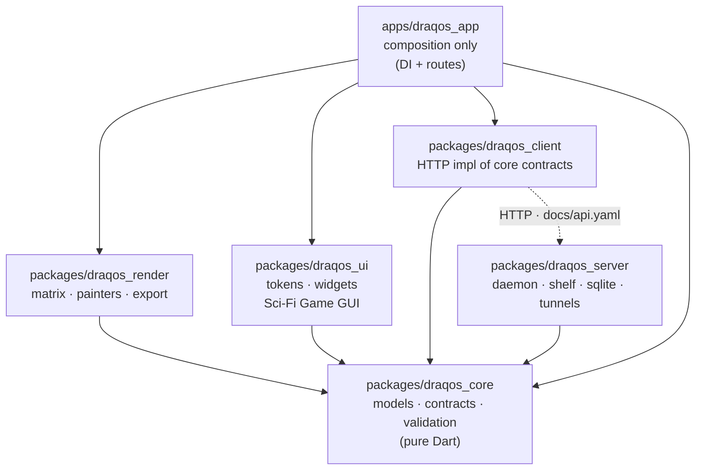

# DRAQOS Architecture

> Dependency rule: everything points **toward the core**.
> UI renders only core interfaces. One OpenAPI contract (`docs/api.yaml`)
> is shared by client and server. All visuals come from design tokens.

## Packages

| Package | Role | May import |
|---|---|---|
| `draqos_core` | Entities (`DynamicQr`, `ScanStats`), `QrStyle`, `DynamicQrRepository`, `ScanRepository`, `TunnelProvider`, validation | Dart SDK only |
| `draqos_render` | QR matrix, `CustomPainter`s, module/eye shapes, auto-contrast, icon overlay, PNG/SVG/PDF export | `core`, Flutter, `qr`, `image`, `pdf` |
| `draqos_ui` | `DraqosTokens` (`ThemeExtension`), `DraqPanel`, `DraqButton`, `DraqSlider`, `DraqColorPicker` | `core`, Flutter only |
| `draqos_client` | HTTP implementation of core repository contracts + pairing | `core`, `http` |
| `draqos_server` | Headless daemon: admin API, 302 redirect + scan counter, tunnel managers | `core`, `shelf`, `sqlite3` |
| `draqos_app` | Composition root: Riverpod providers, routes, screens | `core`, `render`, `ui`, `client` |

## Rules (enforced by `dart tool/check_architecture.dart` in CI)

1. `draqos_core` never imports Flutter.
2. `draqos_ui` / `draqos_render` never import `draqos_client`,
   `draqos_server`, `package:http`, `shelf` or `sqlite3`.
3. `apps/draqos_app` holds no business logic (no `shelf`/`sqlite3`).
4. Visual changes happen only via `DraqosTokens` — swapping the
   design never touches client/server.
